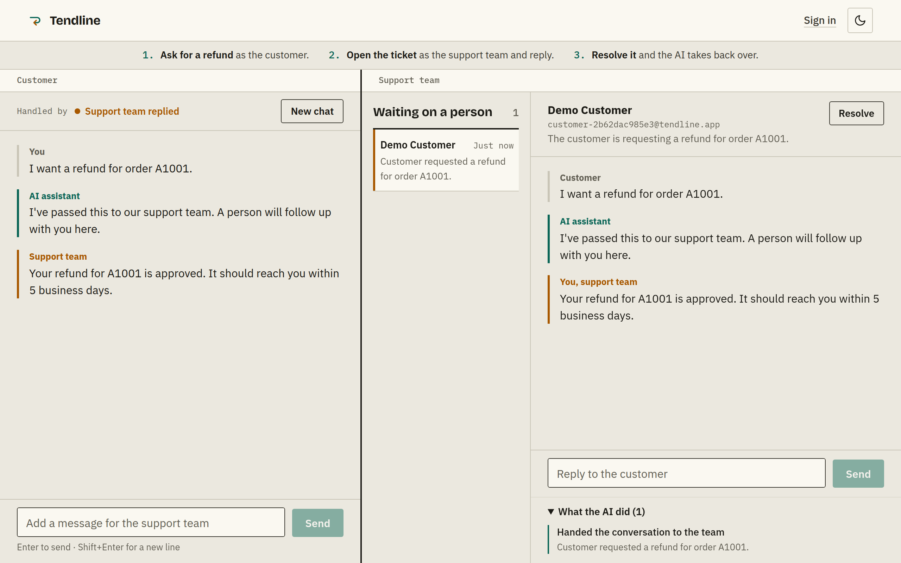
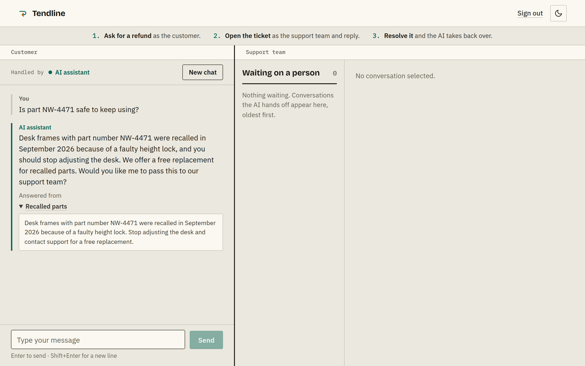

<h1 align="center">🤝 Tendline</h1>

<p align="center">
  <b>AI customer support that knows when to hand off.</b><br/>
  It answers from your help docs, checks real orders and passes anything it shouldn't handle to a person, with the full history attached.
</p>

<p align="center">
  
  
  
  
  
  <a href="LICENSE"></a>
</p>

<p align="center">
  <a href="#-quick-start">Quick start</a> ·
  <a href="#-how-it-works">How it works</a> ·
  <a href="#-features">Features</a> ·
  <a href="#-api">API</a> ·
  <a href="#-limits">Limits</a> ·
  <a href="#-deployment">Deployment</a>
</p>

<p align="center">
  
</p>

---

## 🧭 What is Tendline?

An AI support agent for a made-up desk company, Northwind Desks. A chatbot that answers everything is easy to build and risky to run, so the interesting part here is the boundary: what the model may do on its own, and how the conversation reaches a person when it shouldn't.

| 💬 Answers | 📦 Checks | 🤝 Hands off |
|---|---|---|
| Policy questions from your help docs only, showing the passage it used | Orders for the signed-in customer, and nobody else | Refunds, cancellations, address changes and anything the docs don't cover go to a person |

<p align="center">
  
</p>

## 🚀 Quick start

**Prerequisites:** Python 3.12, Node 18+ and a [Gemini API key](https://aistudio.google.com). No Docker needed: `scripts/dev_db.py` starts a bundled Postgres with pgvector.

Run the backend and frontend in two terminals, backend first.

**1. Backend** → `http://localhost:8020`

```bash
cd Backend
python3 -m venv .venv
.venv/bin/pip install -r requirements-dev.txt
cp .env.example .env                # fill in the values
.venv/bin/python scripts/dev_db.py  # put the printed URL in .env as DATABASE_URL
.venv/bin/python -m app.ingest      # creates tables and accounts, indexes the docs
.venv/bin/uvicorn asgi:app --port 8020
```

**2. Frontend** → `http://localhost:5173`

```bash
cd Frontend
npm install
npm run dev
```

**3. Tests**

```bash
cd Backend
.venv/bin/python -m pytest
```

The tests run against a real local Postgres with a scripted model and embeddings, so they need no API key.

<details>
<summary><b>🔧 Environment variables</b> (<code>Backend/.env</code>)</summary>
<br/>

| Key | Required | Notes |
|---|---|---|
| `DATABASE_URL` | **yes** | Postgres with pgvector. Use the pooled URL on Neon. |
| `JWT_SECRET` | **yes** | Signs session tokens. Use a long random string. |
| `GEMINI_API_KEY` | **yes** | Chat and embeddings. |
| `DEMO_PASSWORD` | ingest | Password for the local accounts. Only read by `app.ingest`. |
| `DEMO_MODE` | no | `1` turns on `/demo`, one-click demo sign-in and the public demo logins. |
| `GEMINI_CHAT_MODEL` | no | Defaults to `models/gemini-3.5-flash-lite`. |
| `GEMINI_FALLBACK_MODEL` | no | Defaults to `models/gemini-3.1-flash-lite`. |
| `CORS_ALLOWED_ORIGINS` | prod | The deployed frontend's address, comma-separated if more than one. |
| `GOOGLE_CLIENT_ID` | no | Turns on "Continue with Google". See **Google sign-in** below. |

Frontend (`Frontend/.env`): `VITE_API_URL` is the deployed backend's address, left empty locally because Vite proxies `/api`. `VITE_GOOGLE_CLIENT_ID` is the same Google client ID, only needed for the Google button.

</details>

<details>
<summary><b>🔑 Google sign-in</b> (optional, free)</summary>
<br/>

Adds a **Continue with Google** button to the sign-in page. New Google users get a customer account with sample orders. Support team accounts always sign in with a password, so staff access can never come from a Google account.

1. In [Google Cloud Console → Credentials](https://console.cloud.google.com/apis/credentials) create an **OAuth client ID** of type **Web application**. If asked, set up the consent screen first (External, app name, your email).
2. Under **Authorized JavaScript origins** add your frontend origins, for example `http://localhost:5173` and `https://<your-app>.vercel.app`. No redirect URI is needed.
3. Put the client ID in `GOOGLE_CLIENT_ID` (backend) **and** `VITE_GOOGLE_CLIENT_ID` (frontend), then redeploy both. There is no client secret in this flow.

Leave both empty and the button is hidden.

</details>

<details>
<summary><b>🔑 Demo accounts</b></summary>
<br/>

With `DEMO_MODE=1`, use the password **`demo1234`** with:

| Email | Role |
|---|---|
| **`demo@tendline.app`** | Customer |
| **`support@tendline.app`** | Support team |

Each sign-in opens a new private workspace with sample orders, deleted after a day, so the password can be public. To see a ticket travel between both roles, open **`/demo`**, which shows them side by side.

`app.ingest` also creates `sara@example.com`, `omar@example.com` (customers) and `agent@example.com` (staff) with `DEMO_PASSWORD`. Only `agent@example.com` can see the real support queue.

</details>

## 🧩 How it works

```
 customer ── message ──▶ /api/chat/stream ──▶ Gemini + tool loop
                                                 │
        search_help_docs ── hybrid search (pgvector + full-text)
        get_order, list_my_orders ── scoped to the signed-in customer
        escalate_to_human ── opens a ticket
                                                 │
        ┌──────────── answered ──────────────────┤
        ▼                                        ▼ hand-off
 reply + checked sources                staff queue: transcript + AI actions
                                                 │ staff reply, then resolve
                                                 ▼
                                        AI assistant takes back over
```

The model only asks for tools. Which customer a tool runs for comes from the signed-in session, so a manipulated model can't reach another customer's orders. While a person has the conversation, the model stays out of it. A hand-off only happens through the tool, and the agent is told never to promise one without it.

## ✨ Features

<table>
<tr>
<td width="50%" valign="top">

### 🔒 Customer scoping in code
Order tools take their customer from the session, never from model output. Asking for someone else's order gets the same answer as an order that doesn't exist.

### 🧯 Automatic hand-off
Model errors, search failures, empty replies and runaway tool loops all reach the staff queue instead of leaving the customer with a broken chat.

### 📚 Sources you can check
Citations are checked against the passages actually retrieved that turn, so the model can't cite something it never read. Customers can open the passage under the answer.

### 🔎 Hybrid search
pgvector handles reworded questions, and Postgres full-text search makes exact codes like part numbers rank first. Results are merged with reciprocal rank fusion.

</td>
<td width="50%" valign="top">

### 🗂️ Staff console
An oldest-first queue with wait times, a "Customer wrote again" flag, the full transcript and a readable record of every tool the AI used.

### 🔁 Model fallback
If the main Gemini model is overloaded, rate-limited or retired, the request moves to a second model before handing off.

### 🪪 Real accounts
scrypt-hashed passwords, signed session tokens, separate customer and staff roles, a temporary lock after repeated failed sign-ins, optional Google sign-in and password change.

### 🧪 Private demos
Every demo visitor gets their own customer and agent who can only see each other. Every staff route checks that workspace, so guessing a ticket ID gets nothing.

</td>
</tr>
</table>

## 🔌 API

Interactive docs at **`/api/docs`**.

| Endpoint | Auth | Purpose |
|---|---|---|
| `POST /api/chat/stream` | Customer | Send a message, with one JSON line per real agent step |
| `POST /api/chat` | Customer | The same, as a single response |
| `GET /api/conversations/latest`, `/api/conversations/<id>` | Customer | Read your own conversations |
| `GET /api/staff/escalations` | Staff | The queue, oldest first |
| `GET /api/staff/conversations/<id>` | Staff | Transcript and AI actions |
| `POST /api/staff/conversations/<id>/reply` | Staff | Reply to the customer |
| `POST /api/staff/escalations/<id>/resolve` | Staff | Close the ticket and return it to the AI |
| `POST /api/login`, `/api/auth/google` | none | Sign in |
| `GET /api/me`, `POST /api/me/password` | Signed in | Your account and password |
| `POST /api/demo/session`, `/api/demo/pair` | none | Private demo workspaces, with `DEMO_MODE=1` |

## 🚦 Limits

| Action | Limit |
|---|---|
| Sign-ins | 20 per 15 minutes, per IP address |
| New demo workspaces | 20 per hour per IP address, 1,000 per day overall |
| Chat messages | 30 per hour per user, 60 per hour per IP address, 300 per day overall |
| Staff replies | 60 per hour, per agent |

Counters live in Postgres so they hold across serverless instances. Blocked requests get a `429` with `Retry-After`.

## 🛠️ Tech stack

| Layer | Tech |
|---|---|
| **Backend** | Python 3.12, FastAPI, psycopg 3, PyJWT |
| **AI** | Google Gemini for chat and embeddings, with function calling through its own tool loop |
| **Frontend** | React 18, Vite, React Router |
| **Data** | PostgreSQL with pgvector and full-text search, on Neon |
| **Deployment** | Vercel (serverless Python + static React) |

## 🗂️ Project structure

```
Tendline/
├── Backend/
│   ├── api/index.py        Vercel entry point
│   ├── app/
│   │   ├── agent.py        tool loop, citations, hand-off rules
│   │   ├── config.py       settings from the environment
│   │   ├── docs_index.py   splits and searches the help docs
│   │   ├── ingest.py       creates tables and accounts, indexes the docs
│   │   ├── llm.py          Gemini client with model fallback
│   │   ├── main.py         API routes, auth, rate limits
│   │   └── store.py        schema and every SQL query
│   ├── data/docs/          the help docs the agent answers from
│   ├── scripts/dev_db.py   bundled local Postgres
│   ├── tests/              62 tests against a real Postgres
│   ├── asgi.py
│   ├── requirements.txt
│   └── vercel.json
├── Frontend/
│   ├── src/
│   │   ├── components/     chat, staff console, ticket log, profile menu
│   │   ├── pages/          landing, sign-in, workspace, split-screen demo
│   │   ├── api.js          API client and streaming
│   │   └── styles.css
│   ├── package.json
│   └── vercel.json
└── docs/screenshots/
```

## ☁️ Deployment

Two **Vercel** projects from this repo, plus a **Neon** database in `us-east-1`. The backend runs in `iad1`, next to the database.

**1. Database:** from `Backend/`, run `python -m app.ingest` against it. Repeat after changing the help docs or schema.

**2. Backend:** a Vercel project with **Root Directory** set to `Backend`. Set `DATABASE_URL`, `JWT_SECRET`, `GEMINI_API_KEY` and `DEMO_MODE`.

**3. Frontend:** a Vercel project with **Root Directory** set to `Frontend`. Set `VITE_API_URL` to the backend's address.

**4. Connect them:** set `CORS_ALLOWED_ORIGINS` on the backend to the frontend's address, then redeploy the backend.

## 📄 License

[MIT](LICENSE) © 2026 Ahmad Zaman
